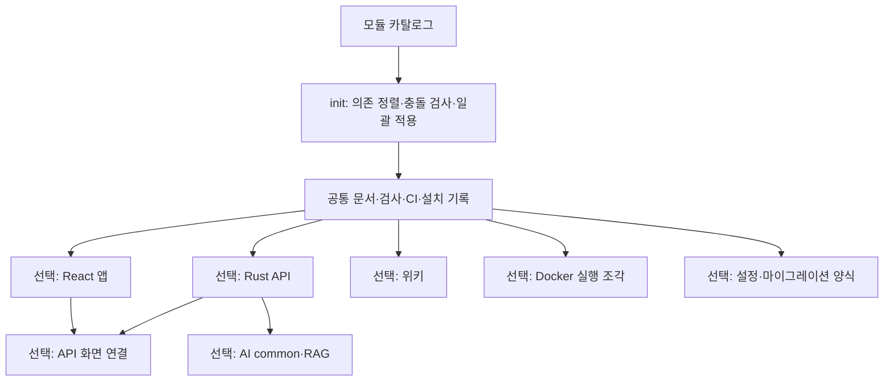

# 모듈 조립 아키텍처

카탈로그와 생성 프로젝트를 분리합니다. 루트는 조립 도구·검증·문서이고 앱 원본은 templates 아래에 있습니다.

각 모듈은 module.json과 files로 구성합니다. 의존 관계·소유권·초기 자료·명시적 연결 블록을 선언하고 생성·추가 시 전체 변경을 먼저 계획합니다. 쓰기 실패 시 완료한 파일을 복원하며 새로 만든 빈 폴더를 정리합니다. 동시 편집이 감지되면 적용을 거부합니다. 모든 파일을 아우르는 OS 수준 원자적 트랜잭션이나 프로세스 간 잠금은 제공하지 않으므로 조립 중 대상 프로젝트를 동시에 수정하지 않습니다.

공통 스크립트는 설치 기록에 있는 앱만 검사합니다. Rust·React는 각각 단독 실행할 수 있고 web-api가 둘을 연결합니다. docker-rust·docker-react·docker-postgres의 Compose 조각은 독립적이며 docker-web-api가 프록시를 추가합니다. compose.py는 설치 순서에 따라 파일을 합치고 프로젝트 이름으로 네트워크·볼륨을 구분합니다.

postgres는 스키마 양식, docker-postgres는 컨테이너·볼륨입니다. 앱 DB 드라이버와 자동 마이그레이션은 구현하지 않습니다. config-yaml도 설정 양식이며 로더가 없습니다. AI RAG는 mock 검색 데모이고 실제 공급자·영속 저장소·인증 경계는 프로젝트에서 연결합니다.

소유 파일을 수정해도 일반 구조 검사는 허용하지만 자동 제거는 거부합니다. 공유 연결 블록은 정확히 한 번 존재해야 합니다. 위키·공통 안내문 같은 seed 파일은 프로젝트 소유로 보존합니다. 업그레이드·사용자 변경 자동 병합은 제공하지 않습니다.

[계약과 모듈 작성](../templates/README.md) · [검증 배치](../tests/README.md)
