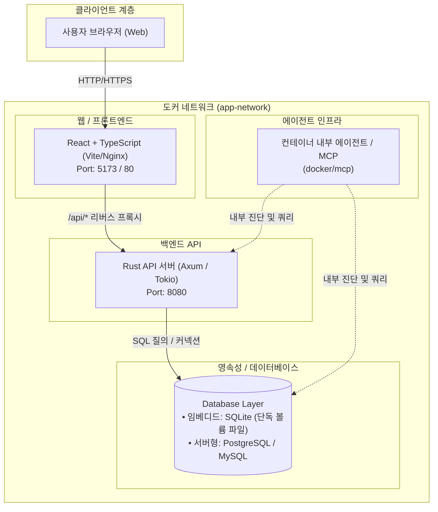

# 아키텍처

## 1. 시스템 개요

본 프로젝트는 고성능 안정성을 보장하는 **Rust 백엔드 API**와 반응형 사용자 인터페이스를 제공하는 **React (TypeScript) 프론트엔드**, 그리고 상황에 맞게 유연하게 선택할 수 있는 **데이터베이스 계층(SQLite, PostgreSQL, MySQL 등)**으로 구성된 풀스택 템플릿 아키텍처입니다.

현재 구현은 두 health API와 이를 조회하는 React 화면입니다. 아래 DB·비즈니스 로직 계층은 확장 시의 설계 예시이며, DB 드라이버·SQLx·인증은 아직 연동하지 않았습니다.

---

## 2. 주요 구성 요소

| 모듈 | 디렉터리 경로 | 기술 스택 | 주요 역할 |
|---|---|---|---|
| **Frontend** | [`frontend/`](../frontend) | React, TypeScript, Vite | health API 조회, 연결 대기·성공·오류 표시 |
| **Backend** | [`backend/`](../backend) | Rust, Axum, Tokio, Serde | `src/lib.rs`의 라우터, `src/main.rs`의 서버 실행 |
| **Database** | [`migrations/`](../migrations) | 선택적 SQL DB (SQLite, PostgreSQL 등) | 마이그레이션 예시; 실제 DB 연동은 확장 시 구현 |
| **Docker** | [`docker/`](../docker) | Docker, Docker Compose, Nginx | 컨테이너화, 멀티스테이지 빌드 파이프라인, MCP 연계 |
| **에이전트 연동** | [`docker/mcp/`](../docker/mcp) | MCP (Model Context Protocol) | 컨테이너 내 에이전트 도구 구성 안내 |

---

## 3. 통신 및 데이터 흐름

1. **클라이언트 요청**:
   * 브라우저에서 정적 웹 리소스(HTML/JS/CSS)를 프론트엔드 컨테이너(개발: Vite, 상용: Nginx)로부터 수신합니다.
2. **API 호출**:
   * 브라우저의 `/api/*` 요청은 프론트엔드 Nginx를 통해 백엔드 컨테이너(`backend:8080`)로 프록시되어 CORS 제약 없이 안전하게 전달됩니다.
3. **백엔드 처리**:
   * 현재는 health 상태와 서비스 이름, 응답 생성 시각을 반환합니다. 비즈니스 규칙과 데이터베이스 통신은 확장 시 추가합니다.
4. **결과 반환**:
   * health 응답은 `status`, `service`, `timestamp` 필드를 사용합니다. 업무용 API를 추가할 때 적용할 공통 규격은 [API 설계 가이드](api/overview.md)를 참고하세요.

---

## 4. 인프라 및 배포 아키텍처

자세한 도커 컨테이너 구성 및 환경별 운용 방법은 [Docker 활용 가이드](docker/README.md)를 참고하세요.
* [단독 실행 가이드 (Standalone)](docker/standalone.md)
* [도커 공유 템플릿 연계 가이드 (Shared Template)](docker/shared-template.md)
* [빌드 최적화 가이드](docker/build-optimization.md)
