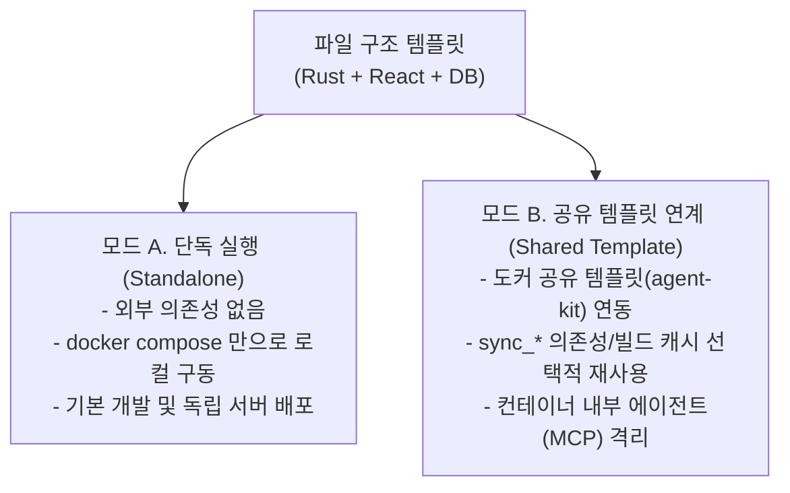
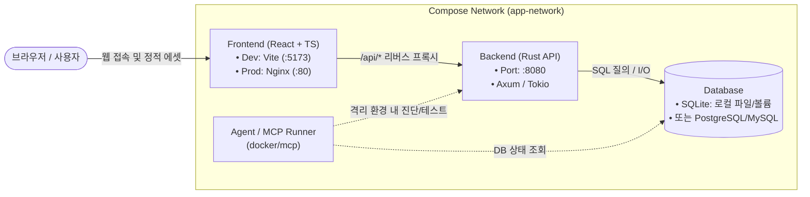

# Docker 활용 가이드

이 문서는 본 템플릿(Rust + TypeScript/React + 유연한 데이터베이스 계층)을 다양한 환경에서 컨테이너 기반으로 개발·빌드·배포하고, 필요에 따라 `도커 공유 템플릿`과 연계하는 방식을 안내합니다.

본 템플릿은 **초기 상태로 어디서든 바로 사용할 수 있는 뼈대**로 설계되었으며, 특정 호스트 환경이나 공유 볼륨을 강제하지 않습니다.

---

## 1. 두 가지 운용 모드

본 템플릿은 환경과 목적에 따라 두 가지 모드로 유연하게 동작합니다.

| 구분 | 모드 A: 단독 실행 (Standalone) | 모드 B: 공유 템플릿 연계 (Shared Template) |
|---|---|---|
| **대상 환경** | 개인 로컬 개발 PC, 단독 CI/CD, 독립 프로덕션 서버 | `도커 공유 템플릿`이 구축된 다중 프로젝트 서버 |
| **의존성** | 호스트에 Docker Engine 및 Docker Compose만 필요 | 호스트의 `agent-kit`, 공용 이미지, 공유 볼륨 |
| **볼륨 전략** | Compose 프로젝트 내 격리된 로컬 볼륨 사용 | 선택적 `sync_*` 볼륨(Crate 캐시 등) 및 `p_*` 볼륨 연동 |
| **Keeper 패턴** | 미사용 (기본 컨테이너 라이프사이클) | `x-keeper` 정지 컨테이너로 볼륨 및 이미지 보존 |
| **상세 안내** | [단독 실행 가이드](standalone.md) | [공유 템플릿 연계 가이드](shared-template.md) |

---

## 2. 컨테이너 아키텍처 및 네트워크 구조

단독 모드와 공유 연계 모드 모두 동일한 기본 서비스 토폴로지를 공유합니다.

---

## 3. 볼륨 명명 및 관리 전략

본 템플릿은 초기 상태에서 순수 로컬 이름으로 동작하며, 공유 서버에서는 표준 명명 규칙을 적용할 수 있습니다.

| 볼륨 용도 | 단독 실행 기본 이름 | 공유 템플릿 연계 시 권장 이름 | 특성 |
|---|---|---|---|
| **데이터베이스 데이터** (SQLite 파일 또는 DB 컨테이너) | `db-data` | `p_db_data_<프로젝트명>` | 프로젝트 영속 데이터 |
| **Rust Crate/빌드 캐시** | `cargo-cache` | `sync_cargo_cache` | 호스트 단위 공유 시 빌드 속도 대폭 향상 |
| **프론트엔드 캐시** | `node-cache` | `p_node_cache_<프로젝트명>` | 프로젝트별 의존성 격리 |
| **에이전트 인증** | (해당 없음) | `sync_agent_auth` | 호스트 공용 에이전트 로그인 재사용 |
| **에이전트 작업 상태** | (해당 없음) | `p_agent_state_<프로젝트명>` | 프로젝트별 세션/메모리 분리 |

---

## 4. 상세 문서 목차

- **[단독 실행 가이드 (Standalone)](standalone.md)**: 기본 Docker Compose로 빠르게 시작하기
- **[공유 템플릿 연계 가이드 (Shared Template)](shared-template.md)**: `agent-kit`, 볼륨 보호, MCP 에이전트 결합
- **[빌드 및 이미지 최적화 (Build Optimization)](build-optimization.md)**: `cargo-chef`와 멀티스테이지 빌드 전략
- **[컨테이너 MCP 가이드](../../docker/mcp/README.md)**: 컨테이너 내부 에이전트를 위한 MCP 서버 설정
