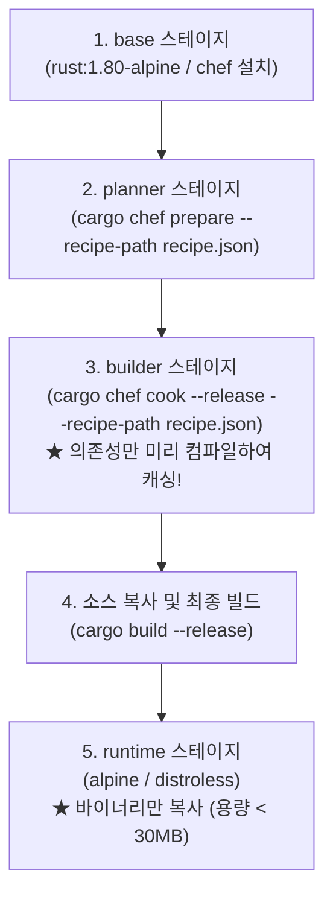
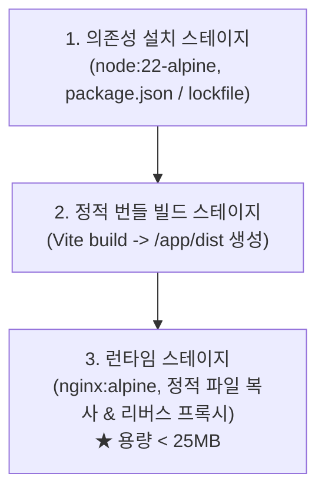

# 빌드 및 이미지 최적화 가이드 (Build Optimization)

Rust와 React(TypeScript)는 개발 생산성과 성능이 뛰어난 조합이지만, 컴파일 언어와 정적 번들러 특성상 올바른 도커 빌드 파이프라인을 구축하지 않으면 이미지 용량이 수 GB에 달하거나 빌드 속도가 크게 느려질 수 있습니다.

본 템플릿에 적용된 멀티스테이지 빌드 및 최적화 전략을 안내합니다.

---

## 1. Rust 백엔드 빌드 최적화 (`cargo-chef`)

Rust는 소스 코드 한 줄만 바뀌어도 모든 의존성을 다시 컴파일하는 문제가 발생하기 쉽습니다. 이를 방지하기 위해 `cargo-chef`를 사용해 의존성 레이어와 소스 코드 레이어를 분리합니다.

### Dockerfile 핵심 설계
* **의존성 캐시 유효**: `Cargo.toml`, `Cargo.lock`이 변경되지 않았다면 의존성 빌드(`cargo chef cook`) 단계는 완전히 캐시되어 수 초 만에 빌드가 완료됩니다.
* **초경량 런타임**: 빌드 도구(Rustc, Cargo, GCC 등)가 포함되지 않고 오직 단일 바이너리와 필수 라이브러리(SSL, musl)만 포함되므로 최종 이미지 용량이 30MB 안팎으로 유지됩니다.

---

## 2. React (TypeScript) 프론트엔드 빌드 최적화

React 웹 애플리케이션은 브라우저에서 실행되는 정적 에셋(HTML, JS, CSS)입니다. 프로덕션 환경에 무거운 Node.js 런타임을 둘 필요가 없습니다.

### Nginx 리버스 프록시 역할
* **단일 오리진 제공**: 클라이언트(브라우저)는 Nginx 포트(예: `:80`)로만 접속합니다.
* **정적 서빙 & 프록시 분기**:
  * `/` 및 정적 리소스 요청: Nginx가 캐싱 헤더와 gzip 압축을 적용하여 즉시 응답
  * `/api/*` 요청: Nginx가 동일 도커 네트워크의 Rust 백엔드(`http://backend:8080`)로 프록시하여 CORS 문제를 원천 제거

---

## 3. 요약: 프로덕션 이미지 크기 비교

| 컴포넌트 | 비최적화 이미지 (단일 스테이지) | 최적화 이미지 (멀티스테이지 적용) |
|---|---|---|
| **Backend (Rust)** | 약 1.8 GB ~ 2.2 GB (Rust 툴체인 포함) | **약 25 MB ~ 35 MB** (단일 바이너리) |
| **Frontend (React)** | 약 800 MB ~ 1.2 GB (Node/npm 포함) | **약 20 MB ~ 30 MB** (Nginx + 정적 에셋) |
| **보안 이점** | 쉘, 패키지 매니저, 개발 도구 노출 | 공격 표면(Attack Surface) 최소화 |
